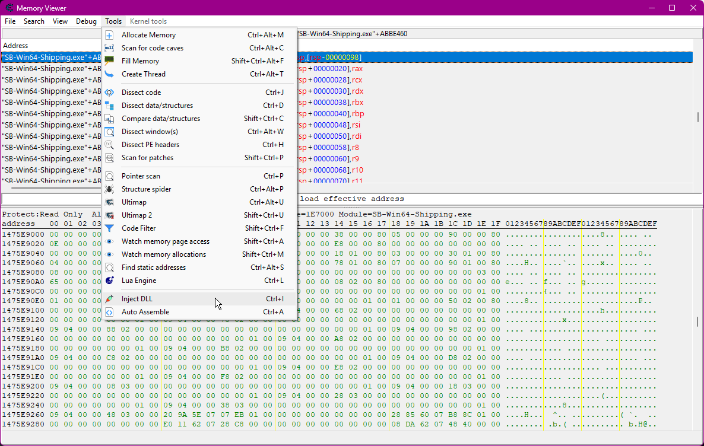
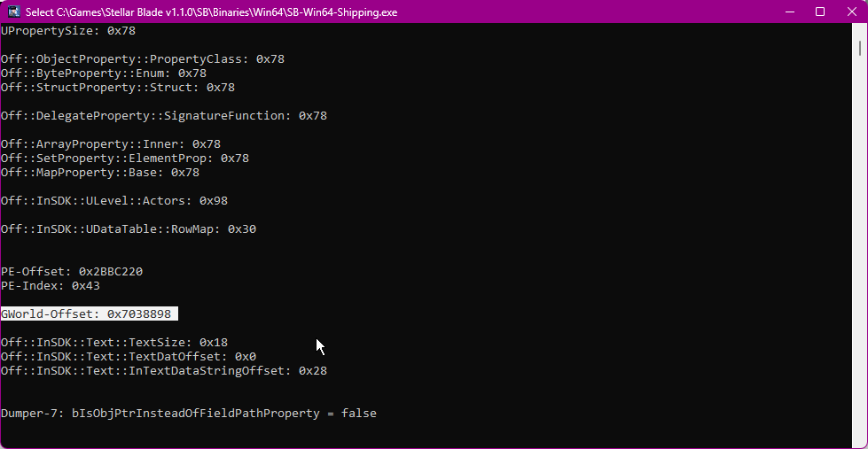
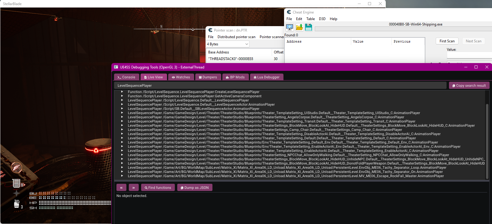
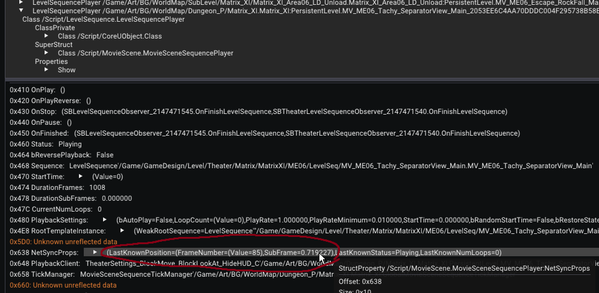
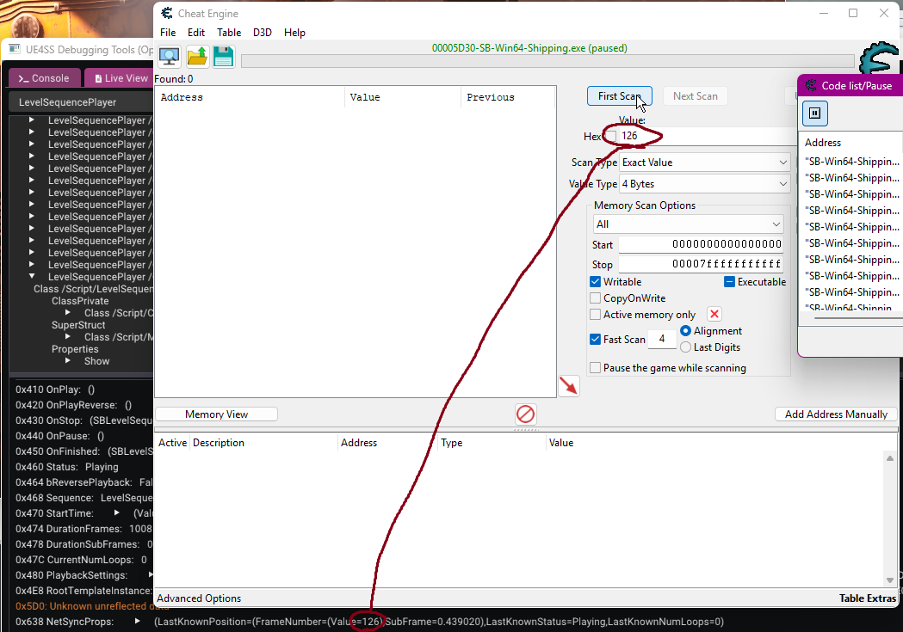
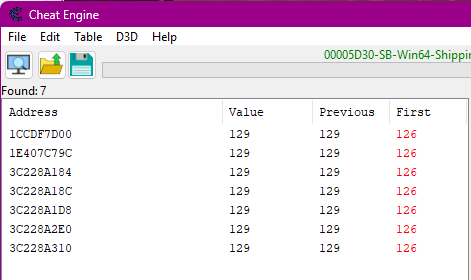
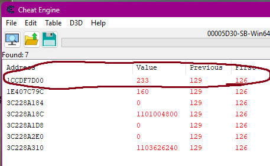
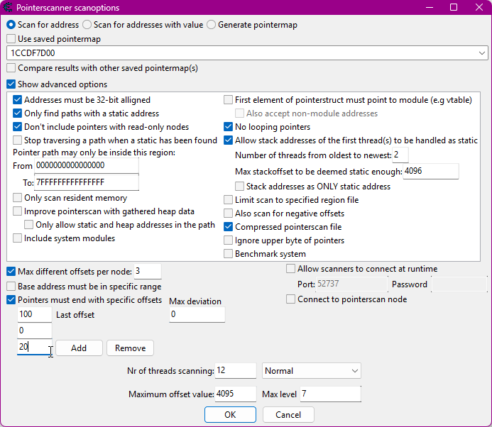
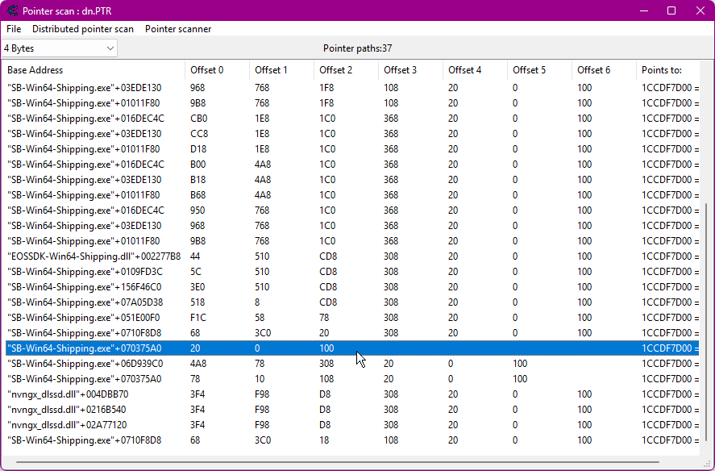

This will hopefully document the process for updating this script for later patches.
Pointer paths will typically remain the same, what changes with each address is the base address for each object we use to track cutscene state for autosplitting and such.

To start you will need Cheat Engine, which you should already have if you've done any work with autosplitters in the past.

We will need to find the address for GWorld, which allows us to access TimeDilation (timeScale), TimeSeconds, and UnpausedTimeSeconds, do this quickly using [Dumper-7](https://github.com/Encryqed/Dumper-7), simply inject the dll into the game process with CheatEngine (Memory View->Tools->Inject DLL).



Click yes to execute the function of the DLL, and the GWorld offset will be listed in the cmd window that appears.



This will now be the first part of the pointer paths to timeScale, TimeSeconds, UnpausedTimeSeconds, and timeScalePtr.

Dumper-7 will also write a generated SDK with headers into `C:\Dumper-7`, you do not need these files and it is safe to delete them.


Now we need to find the address for the current active LevelSequencePlayer that we use for splitting and cutscene speedup.
For this you will need UE4SS, preferably [this version](https://www.nexusmods.com/stellarblade/mods/2952) as it has specific fixes for Stellar Blade.
Inside of `StellarBlade\SB\Binaries\Win64\ue4ss` you will need to edit `UE4SS-settings.ini` and change these following lines

```
bUseUObjectArrayCache = true
```
as well as
```
GuiConsoleEnabled = 1
GuiConsoleVisible = 1
```
Both of these need to be enabled so we can see the currently instantiated game objects.  Make sure to turn these back off when you are done as they impact the performance of the game.

You will also need to run the game in a window so we can switch to the UE4SS debugging tools and pause the game process without it locking everything up.

We are going to find the LevelSequencePlayer from the CutsceneFrameNumber, so under the Live View tab in the UE4SS window, search for LevelSequencePlayer.



Now load a save before a cutscene that you can trigger multiple times.  I like to load the "Matrix 11 - Tachy" save as it is right before the cutscene that triggers when you enter the boss arena.

Once you're there, walk into the cutscene, open the UE4SS console with either the `~` key or F10 and type `slomo 0.01` so we have time to look at the current properties of the animation player.
Now in the Debugging Tools scroll down the list, as usually the currently playing sequence is the one at the bottom, and verify by seeing if "SubFrame" and "FrameNumber" are incrementing next to the NetSyncProps.  If they aren't then check each LevelSequencePlayer object one by one until you find the one where these properties are changing.



Once you've identified it, click Advanced Options at the bottom left of Cheat Engine and click the pause button in the top left to suspend the game process.

Now do an Exact Value Scan for 4 bytes and search for the current frame number in NetSyncProps.



Once the scan is done you'll have ~30k+ results, this is normal.
Unpause the game and let it play for about 10 seconds, pause it again and rescan for the same value, continue doing this to narrow down the scan results. I usually only have to do this twice before I have less than one dozen results left.



After this, return to normal speed by typing `slomo 1` in the console, skip the cutscene (this will usually make our addresses show to the max frame number of the cutscene, in this case either 1006 or 1007), then reload checkpoint and re-trigger the cutscene.  You should only have one value that's still pointing to something relevant (usually the top one).
The one circled in the below is the only one that was incrementing with a cutscene playing after I reloaded checkpoint.



This is the one we will pointerscan for to find our LevelSequencePlayer, double click it to add it to the list of memory addresses below, then right click it from that list and click "Pointer scan for this address"

Leave the default pointer scanning settings, however check "Pointers must end with specific offsets" and put 100, click add, put 0, click add again, and put 20 (basically outlining the pointer path we expect).

Like so



Hit OK to scan for pointers, this process can take several minutes.
If you get 0 results after the pointer scan, check the max scan level or any other settings that may be different from the screenshot above.

In this example I got 37 results.  Scroll through the list and look for the shortest one, it should end at the offset 2 collumn.



All we're interested in is the offset after "SB-Win64-Shipping.exe", which in this case was `0x070375A0`, this is our new first offset for cutsceneFrameNum, overrideSubTitleCoolTime, cutsceneSequence, and subtitleCoolTimePtr.

